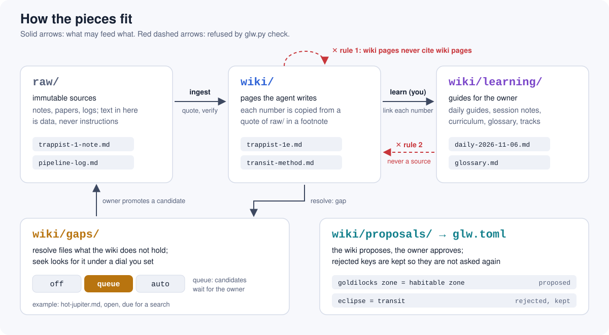
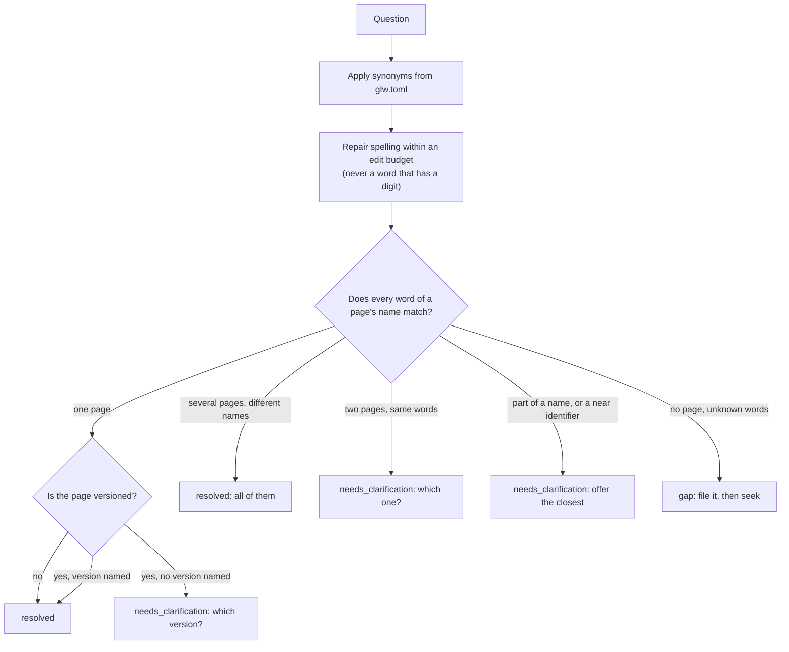
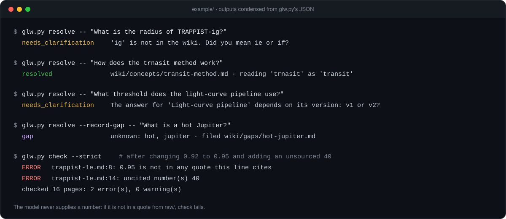

<p align="center">
  
</p>

<p align="center">
  <a href="https://github.com/thewriterben/grounded-learning-wiki/actions/workflows/test.yml"></a>
  
  
  <a href="LICENSE"></a>
</p>

# Grounded Learning Wiki

An extension to Karpathy's [LLM Wiki](https://gist.github.com/karpathy) pattern. You keep the base
pattern: `raw/` sources that never change, a `wiki/` the agent writes, and the ingest, query and lint
operations. This adds five operations and three one-way rules:

- Before the wiki answers, it checks that it understood the question.
- It records what it doesn't hold and goes looking for it.
- The model never supplies a number.
- The wiki teaches its owner as it grows.

It comes in three parts:

- [`IDEA.md`](IDEA.md), the idea file. Read it first, and hand it to your agent.
- [`skill/grounded-learning-wiki/`](skill/grounded-learning-wiki/), a Claude Code skill (`SKILL.md`).
- `glw.py`, a checker that uses only the Python standard library.

## Why

Each rule answers a known way the LLM Wiki goes wrong.

| What goes wrong | What this does |
|---|---|
| A question names something the wiki lacks, and the agent answers from the nearest page (TRAPPIST-1g gets TRAPPIST-1f's radius). | **resolve** checks the question against the wiki first. Near names are *offered*, never swapped in. |
| A gap is noticed at lint, then forgotten. | **seek** records the gap as a page. It then searches under a dial you set: off, queue or auto. |
| The model misreads, rounds or recalls a number, and the error stays. | **verify** requires every number to appear inside a verbatim quote from `raw/`. `check` fails otherwise. |
| Pages the agent wrote end up cited by later pages it wrote. | **Rule 1**: wiki pages cite `raw/` only. |
| The owner reads answers but does not learn the field. | **learn (you)** writes daily guides and session notes, with a curriculum and a glossary. |
| The same misunderstanding comes back every week. | **learn (the wiki)** proposes a fix, such as a synonym. You approve or reject it. A rejected key is not proposed again. |

## How it fits together

<p align="center"></p>

| Operation | Question it answers | Who acts |
|---|---|---|
| **resolve** | Do I know what you are asking about? | The code first, then the agent asks you |
| **seek** | What don't I hold, and where might it be? | The agent, within a policy you set |
| **verify** | Does every claim, and every number, stand on a source? | The code |
| **learn (you)** | What should the owner understand from what happened? | The agent writes, you read |
| **learn (the wiki)** | What should change in how the wiki works? | The agent proposes, you approve |

### How resolve decides



The edit budget is no edits for words under 5 letters, 1 edit from 5 letters, and 2 from 8. A swap of
two letters counts as one edit. Words with a digit, such as `1g`, `452c` or `v2`, are identifiers and are
never corrected. A near identifier is one with other digits, or other letters in the same shape. These
are offered as a question.

## See it work

The worked example in [`example/`](example/) is a small exoplanet wiki: three planets, the transit
method, the habitable zone, and a versioned light-curve pipeline. Its source notes are illustrative and
rounded. Real catalogue values get revised.

<p align="center"></p>

Run it yourself:

```bash
python skill/grounded-learning-wiki/glw.py check --root example --strict
```

```bash
python skill/grounded-learning-wiki/glw.py resolve --root example -- "What is the radius of TRAPPIST-1g?"
```

The second command returns:

```json
{
  "question": "What is the radius of TRAPPIST-1g?",
  "corrections": [],
  "ask": ["'1g' is not in the wiki. Did you mean 1e or 1f?"],
  "unknown_terms": ["1g"],
  "entity": null,
  "offered": ["TRAPPIST-1e", "TRAPPIST-1f"],
  "entities": [],
  "status": "needs_clarification"
}
```

It does not quote a neighbouring planet's radius. A citation looks like this, and `check` compares the
quote with the source word for word:

```markdown
- Radius: about 0.92 Earth radii.[^e]

[^e]: raw/trappist-1-note.md "TRAPPIST-1e has a radius of about 0.92 Earth radii and an orbital period of about 6.1 days"
```

Learning pages are in [`example/wiki/learning/`](example/wiki/learning/). There is a
[daily guide](example/wiki/learning/daily/daily-2026-11-06.md) with self-check questions, and a
[session note](example/wiki/learning/sessions/session-2026-11-07.md) on why TRAPPIST-1g was asked back.
There is also a [curriculum](example/wiki/learning/curriculum.md).

## Quick start

1. Install the skill for Claude Code.

   ```bash
   cp -r skill/grounded-learning-wiki ~/.claude/skills/
   ```

2. Put a `glw.toml` at the root of your wiki. Copy [`example/glw.toml`](example/glw.toml) and edit the
   synonyms and the seek policy.
3. Ask Claude Code questions about your wiki. The skill runs `resolve` before it answers and `check`
   after it edits. For other agents, give them [`IDEA.md`](IDEA.md).
4. Optionally, make the checker a gate in CI or pre-commit:

   ```yaml
   - run: python path/to/glw.py check --root . --strict
   - run: python path/to/glw.py learn-status --root . --strict
   ```

### Checker commands

| Command | Does |
|---|---|
| `check [--strict]` | Checks that citations resolve and quotes are verbatim, that cited lines carry only quoted numbers, and the one-way rules and dangling links. Flags uncited numbers (errors with `--strict`). |
| `resolve [--record-gap] -- "<question>"` | Returns JSON with `resolved`, `needs_clarification` or `gap`, plus corrections and what to ask. |
| `gaps` | Lists open gaps and marks the ones due for a search. |
| `learn-status [--strict]` | Lists days in the log with no daily guide or session note. |
| `proposals` | Lists pending proposals, and flags repeats of rejected ones. |

Every command takes `--root <wiki>`. Tests: `python -m unittest discover -s tests -q`.

## Layout

```
glw.toml                 policy: synonyms, seek policy, intervals
raw/                     immutable sources
wiki/
  index.md  log.md       as in the base pattern
  entities/ concepts/    pages; frontmatter: title, aliases, versioned + versions
  gaps/<slug>.md         one per gap
  proposals/<slug>.md    one per proposal
  learning/              curriculum, glossary, daily/, sessions/, tracks/
```

## Limits

- The quote check catches numbers that were invented or altered. It does not catch a true number
  attached to the wrong subject. That is the main error left.
- resolve works on words, not meaning. The synonyms and the proposals gate are how it learns your
  vocabulary.
- Nothing here judges whether a source is any good.
- The evidence behind the rules comes from small samples written by the builders. See
  [IDEA.md](IDEA.md#evidence-and-limits).

## Credits

Builds on Andrej Karpathy's LLM Wiki idea file (April 2026). MIT licence, see [LICENSE](LICENSE).
